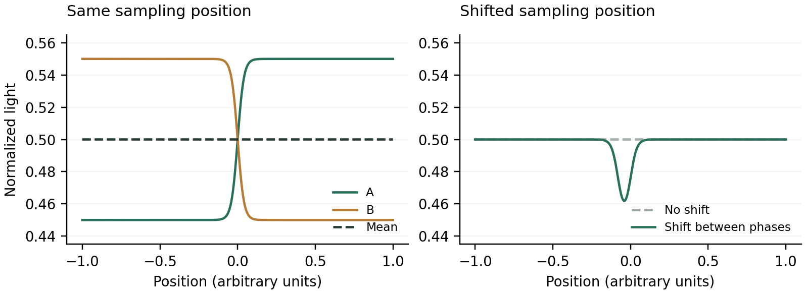

I saw a reel that made this look suspiciously easy to test: flash an image and its inverse fast enough, and your eyes average them into gray. The picture disappears. Naturally, I wanted to do this with a moving bunny.

So I built a browser experiment around Big Buck Bunny and ran it on a MacBook Pro. Show the video. Show its inverse. Repeat as quickly as the browser will present distinct frames. How complicated could subtraction possibly get?

The first attempts still showed the video. Then there were live timing controls, different inversion models, and a growing collection of ways for an edge to survive perfectly respectable arithmetic. The useful configuration ended up looking like this:

| Control | Setting |
| --- | --- |
| A / B holds | 1 frame / 1 frame, linked |
| Estimated hold duration | 8.3 ms each |
| Effect contrast | 10% |
| Inversion method | Custom display gamma inverse |
| Gamma model | 2.20 |
| Edge softening | 1.00 source-video pixel |
| Fixation dot / frozen motion | On / off |

The screenshot also captured the timing readout:

```text
Browser cadence, estimated       ≈ 120.5/s
A ↔ B changes, last second        ≈ 121.0/s
Complete pairs per second        ≈  60.5/s
Estimated missed refreshes                1
A/B callback exposure          49.8% / 50.2%
```

That is the run I am describing. A useful visual cancellation effect, with the occasional contours that had sent me down this rabbit hole. It is not a claim that every frame became undetectable. Also, those numbers are browser timing estimates. I had not secretly turned the MacBook into a photometer.

## The part that really does cancel

Start with emitted light, because that is what reaches the eye. Let S(x) be a spatial pattern between −1 and 1. Let L₀ be the mean light level and c its modulation amplitude. The ideal pair is:

$$
A(x)=L_0+cS(x),\qquad B(x)=L_0-cS(x)
$$

Give each image the same exposure, then take the average:

$$
\overline{L}(x)=\frac{A(x)+B(x)}{2}=L_0
$$

Every position has the same average. No bunny-shaped term remains. This identity is the good part of the original claim. The extra assumption is that perception at this switching rate behaves enough like that average for the structure to disappear.

Now let A occupy fraction p of the exposure. Suddenly timing is part of the image:

$$
\overline{L}(x)=pA(x)+(1-p)B(x)=L_0+(2p-1)cS(x)
$$

At 55/45 exposure, 10% of the original modulation survives. With two frames of A and one of B, one third survives. Faster switching does not fix a duty cycle that keeps rebuilding the picture.

The screenshot's 49.8/50.2 split gives |2p − 1| = 0.004: a residual equal to 0.4% of the phase modulation in this ideal model. With c = 0.05, that is at most 0.0002 of the normalized full light range. That calculation describes the reported callback balance, not measured screen output, and it does not explain all the contours.

## A moving video adds another opportunity

The inverse has to belong to the same source frame. If I show S at time t and invert a different video frame at t + Δt, the pair contains:

$$
\overline{L}(x)-L_0=\frac{c}{2}[S(x,t)-S(x,t+\Delta t)]
$$

Moving outlines can survive that subtraction. The renderer therefore captures the video at the start of A and reuses that texture for B. The video continues playing; the next pair can capture a newer frame. Motion is allowed between pairs. It is held constant inside each pair.

## The inverse of a number is not the inverse of light

My intuitive inverse was the obvious one: take a pixel value v between 0 and 1 and use 1 − v. The two numbers average to 0.5. Unfortunately, a display is allowed to have opinions about what a number means.

Use the simplified, normalized display model f(v) = vᵞ. With γ = 2.2, the mean light from a code value and its ordinary inverse is:

$$
\overline{L}(v)=\frac{v^{2.2}+(1-v)^{2.2}}{2}
$$

For v = 0 or 1, the mean is 0.5. For v = 0.5, it is about 0.218. The average is still carrying spatial information. I had asked two pixel codes to cancel while leaving their light output out of the discussion.

For a static transfer function f with a usable inverse, the complementary code is instead:

$$
v_B=f^{-1}(1-f(v_A))=(1-v_A^{\gamma})^{1/\gamma}
$$

The custom-gamma mode uses this model. More specifically, it takes a grayscale source value g and first builds a low-contrast target in modeled light:

$$
\ell_A=0.5+C(g-0.5),\qquad \ell_B=1-\ell_A
$$

At the screenshot's C = 0.10, that target stays between 0.45 and 0.55. For an extreme black/white pattern, its modeled Michelson contrast is (0.55 − 0.45)/(0.55 + 0.45) = 0.10. This control is effect contrast, not screen brightness.

```javascript
// Essential gamma-mode path; q rounds to 8-bit codes.
const q = v => Math.round(255 * v) / 255;
const lightA = 0.5 + contrast * (gray - 0.5);
const a = q(lightA ** (1 / gamma));
const b = q((1 - a ** gamma) ** (1 / gamma));
```

B is calculated from the quantized A that is actually sent onward. Rounding A and B independently from ideal values adds another avoidable mismatch. Eight-bit output still leaves rounding error.

Gamma 2.20 is a setting that was used, not a calibration result for this MacBook Pro. The app also offers a piecewise sRGB model. Neither option measures the complete path through browser color handling, the operating system, and the panel. Inverting a model exactly is a smaller achievement than inverting a display exactly.

## As fast as possible still needs two frames

The fastest useful sequence is A, B, A, B, with one presentation opportunity per phase. Running a JavaScript loop faster can update a variable thousands of times while the screen presents only the final state. I need alternating visible frames, not an impressive loop counter.

The app uses requestAnimationFrame, which generally follows the display's rendering cadence. Its timestamps belong to browser scheduling; they are not timestamps of photons leaving individual pixels. [1]

For a cadence r and holds of nA and nB frames, the target pair rate is:

$$
f_{\rm pair}=\frac{r}{n_A+n_B},\qquad T_A=\frac{n_A}{r},\quad T_B=\frac{n_B}{r}
$$

At approximately 120.5 callbacks per second, equal one-frame holds mean about 8.30 ms each and 60.25 complete cycles per second. The screenshot's target readout was 60.24, consistent with those rounded values. Its separate rolling transition counter reports 121 changes and therefore 60.5 pairs per second. Different estimation windows can give slightly different numbers.

So this was roughly 120 changes per second, or roughly 60 complete A/B cycles per second. Calling both of those '120 Hz' would make the write-up look faster than the experiment.

The millisecond inputs are converted to whole frame counts. Typing 1 ms does not create a 1 ms exposure on a display presenting a new state about every 8.3 ms. At the fastest setting, there is nowhere lower for the software hold to go.

## The controls were part of the experiment

A and B can be linked or adjusted separately. Source and image parameters are retained together for each complete pair, so changing gamma halfway through a live session does not deliberately pair one image model with a different inverse model. Timing controls can take effect immediately; I let the settings settle before judging a configuration.

The average views answer two different questions. The 50/50 reference shows the calculated equal-exposure mean. The timing-weighted view uses p = nA/(nA + nB), which is the relevant model when I deliberately make the holds unequal. Both are computed images, not recordings of emitted light.

The MacBook Pro is the machine this run happened on. The screenshot establishes an approximately 120/s browser cadence during the test; it does not identify the model, prove a fixed physical refresh rate, or give permission to extrapolate the result to every MacBook Pro.

## Why the contours were the interesting part

A uniform screen-space mean is useful, but my eye is not bolted to one screen coordinate. Suppose the eye samples the two phases at positions shifted by gA and gB. Even with an otherwise ideal pair, a simple sampling model gives:

$$
\overline{L}_{\rm retinal}(x)=L_0+\frac{c}{2}[S(x+g_A)-S(x+g_B)]
$$

For a small relative shift δ, the residual is approximately proportional to cδS′(x)/2. Sharp edges have large spatial derivatives. That is exactly where this model predicts trouble.



*Illustrative calculation, not eye-tracking data. Shifting one phase's sampling position leaves a residual near the edge even though the unshifted mean is flat.*

This makes eye movement a plausible contributor, not a diagnosis of my particular contours. Davis, Hsieh, and Lee tested rapid image/inverse patterns with a DLP projector and found edge-related artifacts at rates above 500 Hz under their conditions. Their proposed eye-movement explanation is especially relevant here, but their experiment does not give my laptop a universal required refresh rate. [2]

There are also ways to lose cancellation before perception. In measurements of two LCDs, Hallum and Cloherty found that similar specifications concealed different optical responses, including luminance-dependent temporal behavior. That establishes a reason to measure the waveform; it does not establish which artifact this MacBook has. [3]

And perception itself need not average first. A toy rectifier gives mean(S, −S) = 0 while mean(|S|, |−S|) = |S|. Kelly's frequency-doubling experiments demonstrate nonlinear responses for particular counterphasing gratings. That is a useful warning about the averaging story, not evidence that every bunny outline is frequency doubling. [4]

The 1-pixel softening and 10% contrast make this a gentler stimulus. Lower contrast reduces the signal; softer edges reduce steep gradients. Those changes can make cancellation look more convincing while also making the original structure harder to see. I cannot count all of that improvement as more accurate inversion.

## Giving the bunny a simpler control experiment

A natural video has motion, textures, many gray levels, and a bunny with very little interest in experimental control. I added two-level edges and stripes so I could ask a narrower question.

Choose two output codes, u and v. In A, one region receives u and the other receives v. In B, swap them. Under any static, spatially uniform transfer function f, every position now gets the same mean:

$$
\overline{L}(x)=\frac{f(u)+f(v)}{2}
$$

I no longer need to guess the shape of the gamma curve to establish equal means in this model. Every pixel receives the same unordered pair of levels. Temporal response, unequal exposure, edge scaling, and retinal sampling can still interfere; the diagnostic removes one confound rather than declaring the whole system solved.

The app has eight randomized horizontal/vertical orientation trials with fixed settings and feedback deferred until the end. Chance expectation is four correct. Eight trials are exploratory, and onset or offset cues can help. No trial score is reported here.

## What I would actually reproduce

To reproduce: bunny source; custom gamma 2.20; contrast 10%; softening 1.00 source pixel; fixation dot on; motion unfrozen; linked one-frame A/B holds. Use the app's acknowledgement and Stop/Esc controls. Keep viewing and display conditions steady, and record the actual timing readouts.

Then change one thing. Freeze the source. Compare a sharp two-level edge with the video. Compare the calculated mean with the alternating sequence. A flat computed mean and a visible alternating contour are different observations; that distinction justifies the controls.

## What worked

The claim was worth testing. An image and a suitable complement really can have a spatially uniform time average. On this MacBook Pro run, roughly 120 browser updates per second, equal holds, low contrast, and model-based light inversion made a useful cancellation demo. Occasional contours kept the result honest.

Offscreen tests checked production-shader sample pixels; timing tests checked scheduling and pairing. Measuring this screen's optical response would need a fast photodiode and luminance measurements.

I started with 'surely v + (1 − v) is enough.' I ended up caring which v, in which space, for how long, and at which position on the retina. That is a lot of bookkeeping for making a bunny less visible. At least the bunny finally justified the sliders.

## References and the experiment

The equations above are models used to reason about this demo. The papers below support the specific display and visual mechanisms discussed, rather than certifying this MacBook configuration.

[1] [MDN Web Docs. Window: requestAnimationFrame() method.](https://developer.mozilla.org/en-US/docs/Web/API/Window/requestAnimationFrame)

[2] [Davis J, Hsieh Y-H, Lee H-C (2015). Humans perceive flicker artifacts at 500 Hz. Scientific Reports 5:7861.](https://doi.org/10.1038/srep07861)

[3] [Hallum LE, Cloherty SL (2021). Liquid-Crystal Display (LCD) of achromatic, mean-modulated flicker in clinical assessment and experimental studies of visual systems. PLOS ONE 16(3):e0248180.](https://doi.org/10.1371/journal.pone.0248180)

[4] [Kelly DH (1981). Nonlinear visual responses to flickering sinusoidal gratings. Journal of the Optical Society of America 71(9):1051-1055.](https://doi.org/10.1364/JOSA.71.001051)

[5] [Related reading: Falconbridge M, Ware A, MacLeod DIA (2010). Imperceptibly rapid contrast modulations processed in cortex: Evidence from psychophysics. Journal of Vision 10(8):21. Perceptual invisibility and orientation-specific adaptation are separate outcomes in this work.](https://doi.org/10.1167/10.8.21)

[6] [Inverse Vision Lab. The live experiment, with video playback, frame holds, inversion models, calculated means, diagnostic patterns, and exploratory orientation trials.](https://inverse-vision-lab.satuke.chatgpt.site)

Video credit: Big Buck Bunny, © 2008 Blender Foundation, www.bigbuckbunny.org, CC BY 3.0. The demo uses a resized excerpt with audio removed; grayscale, contrast reduction, softening, and inversion are applied for the experiment.

[Big Buck Bunny project and license information.](https://peach.blender.org/about/)
